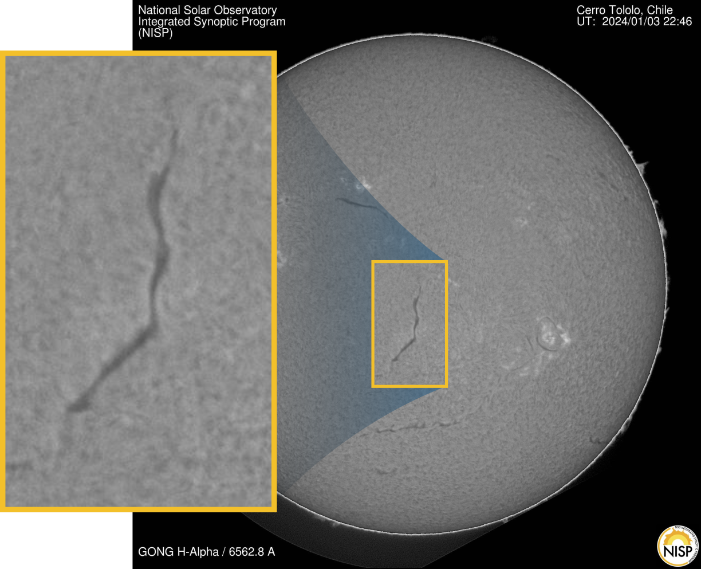
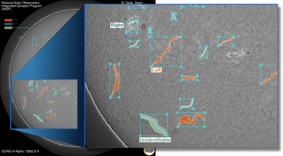

# EquiNexus: Solar Filament Segmentation

[](https://www.python.org/)
[](https://pytorch.org/)
[](https://www.kaggle.com/competitions/filament-segmentation-2026)
[](https://www.kaggle.com/competitions/filament-segmentation-2026)
[](reports/final/technical-report.pdf)
[](https://github.com/BrownAssassin/EquiNexus/releases/tag/filament-final-2026)
[](LICENSE)
[](https://github.com/BrownAssassin/EquiNexus)

Team EquiNexus' submission repository for the **Solar Filament Segmentation Challenge 2026** hosted by the **Earth-Space AI Research (ESAIR) Lab**

## Table of Contents

- [EquiNexus: Solar Filament Segmentation](#equinexus-solar-filament-segmentation)
  - [Table of Contents](#table-of-contents)
  - [Challenge Overview](#challenge-overview)
  - [Team Info](#team-info)
  - [Technical Description](#technical-description)
    - [What Are Solar Filaments?](#what-are-solar-filaments)
    - [What Is MAGFiLO?](#what-is-magfilo)
    - [What Are the Main Challenges?](#what-are-the-main-challenges)
    - [Submission Details](#submission-details)
      - [Models and weights](#models-and-weights)
      - [Training data and validation](#training-data-and-validation)
      - [Test-time inference and consensus](#test-time-inference-and-consensus)
  - [Evaluation and Ranking](#evaluation-and-ranking)
    - [Evaluation rubric and data rules](#evaluation-rubric-and-data-rules)
    - [Panoptic Quality and leaderboard score](#panoptic-quality-and-leaderboard-score)
    - [Submission file format](#submission-file-format)
  - [Reproduction Instructions](#reproduction-instructions)
  - [Acknowledgements](#acknowledgements)
  - [Citations and External Resources](#citations-and-external-resources)
    - [Competition, data, and scoring](#competition-data-and-scoring)
    - [Model weights, code, and software](#model-weights-code-and-software)

## Challenge Overview

The [*Solar Filament Segmentation Challenge 2026*](https://www.kaggle.com/competitions/filament-segmentation-2026) asked participants to develop methods for automatically segmenting individual solar filaments in GONG H-alpha observations. The challenge allows a range of approaches, from traditional image processing to machine learning and deep neural networks.

Each filament should receive its own mask, capturing its full extent and fine-scale structures while avoiding surrounding non-filament regions. The updated goal focuses on pixel-level segmentation quality measured by Panoptic Quality (PQ), while also considering fragmentation, over-merging, and end-to-end computational efficiency.

## Team Info

- **Team Name:** EquiNexus
- **Team Members:**
  - [Mrinank Sivakumar](https://github.com/BrownAssassin) ([Kaggle](https://www.kaggle.com/mrinanksivakumar))
  - [Arv Bali](https://github.com/ArvBali2101) ([Kaggle](https://www.kaggle.com/arvbali))
  - [Thai Le](https://github.com/lolmrdabbydab) ([Kaggle](https://www.kaggle.com/lolmrdabbydab))

## Technical Description

The following background information mirrors the [*Description*](https://www.kaggle.com/competitions/filament-segmentation-2026/overview/description) section of the official competition overview.

### What Are Solar Filaments?

Solar filaments are dense clouds of solar material held above photospheric neutral lines by magnetic fields. They are important to space-weather research because they are associated with eruptions such as coronal mass ejections, solar flares, and solar energetic-particle storms. Earth-directed eruptions can affect power systems, GPS, aviation, and astronauts beyond Earth's magnetosphere.



### What Is MAGFiLO?

MAGFiLO (short for *Manually Annotated GONG Filaments from H-Alpha Observations*) is the expert-annotated source of filament segmentation masks used to develop and evaluate computer-vision methods. Although MAGFiLO contains other labels, including bounding boxes, filament spines, and classes, this challenge evaluates filament segmentation masks. MAGFiLO is the common testbed for participant models. Read the [MAGFiLO dataset paper](https://doi.org/10.1038/s41597-024-03876-y) or visit the competition's [*Data*](https://www.kaggle.com/competitions/filament-segmentation-2026/data) tab.

The illustration shows an H-alpha solar observation with filaments marked by expert annotators.



### What Are the Main Challenges?

Solar-filament segmentation remains difficult even as object-segmentation methods have advanced. The main challenges are:

- **Fine-scale structures:** Thin branches called barbs extend from the main filament. Capturing them and their orientation relative to the spine is important for representing filament morphology and magnetic-field structure.
- **Background noise and image quality:** Ground-based observations contain noise and imaging artifacts, making it hard to distinguish dark filament material from other background structures.
- **Structural continuity:** A method must preserve each filament as a coherent structure. Fragmented masks or merged groups of nearby dark regions can misrepresent its morphology.

### Submission Details

The selected submission is a test-time consensus of three independently produced instance-segmentation families. Kaggle submission **58359982** received a **public leaderboard PQ of 0.40**, the highest public score among our five completed uploads. This is a leaderboard result, not a private-set score. The selected three-family consensus has no EquiNexus grouped OOF score; the OOF results below describe the U-Net + YOLO11s component family only.

#### Models and weights

| Prediction family | Model composition | Weight source and terms |
| --- | --- | --- |
| EquiNexus U-Net + YOLO11s | Ten U-Nets: five ResNet34 and five EfficientNetV2-S models; plus five YOLO11s-seg fold models | Public U-Net checkpoints by [Dariush Afshar](https://www.kaggle.com/datasets/dariushafshar/solar-filament-unet-weights), CC BY-NC-SA 4.0; EquiNexus YOLO11s weights and code, AGPL-3.0 |
| HDJoJo YOLO26x | Public YOLO26x segmentation checkpoint | [HDJoJo model](https://www.kaggle.com/models/hdjojo/yolo26x-seg-solar-filament), Apache-2.0 weights; Ultralytics runtime, AGPL-3.0 |
| I079 detector + refiner | Public Mask R-CNN detector followed by a mask refiner | [I079 weights](https://www.kaggle.com/models/phuongncn/solar-filament-i079-weights), Apache-2.0 |

The final weights archive contains 18 model files, their SHA-256 hashes, and the corresponding notices. It is available from the [`filament-final-2026` release](https://github.com/BrownAssassin/EquiNexus/releases/tag/filament-final-2026); detailed attribution and license terms are listed in [`THIRD_PARTY_NOTICES.md`](licenses/THIRD_PARTY_NOTICES.md). The final package uses no test labels.

#### Training data and validation

The competition-provided training partition contains 707 observations and 1,154 annotator views. Our frozen split groups every view from an observation together, uses seed 42, and stratifies by capture year. The 565-observation development partition is divided into five folds of 113 observations; the remaining 142 observations were reserved from our YOLO training and OOF model selection. The split manifest SHA-256 is `30cb2ec52437daf97e769a3a61bf83350062e6cf4f5d00af1f8399649065e48e`.

The five YOLO11s-seg models were initialized from public COCO weights and trained only with competition-provided training annotations. Each fold used 452 training and 113 validation observations, with a 1,280-pixel image size, batch size 2, a maximum of 40 epochs, and early stopping patience 12. The five recorded fold training durations sum to **6.74 hours**; this is the cumulative sum of fold-run times, not a single end-to-end wall-clock measurement. The U-Net checkpoints were trained and published upstream using grouped folds of the competition training annotations; the publisher's training wall time is not available in the recorded metadata. We use ImageNet initialization for the U-Net encoders and COCO initialization for YOLO11s.

At confidence 0.25, the U-Net + YOLO11s component family reached **OOF PQ 0.459116** across 565 development observations and 922 annotator views (observation-bootstrap 95% interval 0.4491–0.4692). The public U-Net checkpoint pool was trained on the full competition training partition, including observations in the reserved 142-observation split. We therefore do not present that split as an independent holdout for the combined system, and do not attribute the component OOF score to the selected three-family consensus.

#### Test-time inference and consensus

Inference uses the 180 H-alpha images supplied in the competition test input. For U-Net inference, each image is normalized using its mean and standard deviation within a centered 950-pixel solar disk; eight rotations/reflections are averaged, and probabilities above 0.35 are converted to 8-connected components. Components are retained only when peak probability is greater than 0.99, mean probability is at least 0.85, and area is at least 200 pixels. The YOLO11s models also use eight rotations/reflections; detections use confidence 0.25, NMS IoU 0.60, a limit of 150 instances per transform, and mask-IoU 0.30 duplicate suppression. The final consensus compares instance masks from the three families: a mask must receive support from at least two families at IoU greater than 0.50; if exactly two families support it, both overlaps must be at least 0.60. Overlap clipping retains at least half of a mask's area. If an image has no qualifying consensus mask, a deterministic highest-vote fallback is used.

The resulting masks receive unique per-image instance IDs and are encoded as COCO RLE at 2048 × 2048 resolution. Validation checks test-image coverage, mask dimensions and round trips, nonempty masks, unique IDs, and zero overlap between instances in an image. On an NVIDIA GeForce RTX 5070 Laptop GPU with 8 GB VRAM, a local replay of the ten-model U-Net plus five-fold YOLO11s component pipeline took 5,569.7 seconds (about 92.8 minutes), including validation. This is not the full three-family inference runtime: building the final consensus from cached family prediction files took 36.1 seconds, excluding the model inference that produced those files. The replay ran with Python 3.12.10, PyTorch 2.15.0+cu132, and Ultralytics 8.4.173; the full pinned environment is in [`requirements.txt`](requirements.txt).

## Evaluation and Ranking

The organizers assess submissions using both quantitative results and qualitative review. The public leaderboard is one consideration in the final evaluation, rather than the sole ranking criterion.

### Evaluation rubric and data rules

- **Quantitative comparison (70%):** Panoptic Quality (PQ), the distributions of Dice and IoU scores, and the frequency of one-to-many and many-to-one relationships between predicted and ground-truth instances.
- **Qualitative comparison (30%):** a detailed account of the complete pipeline, including preprocessing and model architecture; the apparent morphology of predicted masks on H-alpha images; and source-code quality, including modularity and documentation.

External data and tools may be used subject to the competition rules and each source's access and license terms. For machine-learning inference, the model input must be limited to the H-alpha images in the supplied test directory; training must not use other ground-truth metadata. Final review also depends on public availability of the source code. See the [official competition overview](https://www.kaggle.com/competitions/filament-segmentation-2026/overview) and [competition rules](https://www.kaggle.com/competitions/filament-segmentation-2026/rules).

### Panoptic Quality and leaderboard score

Submissions are evaluated against MAGFiLO instance masks. Let $Y$ be the set of ground-truth instances and $\hat{Y}$ the set of predicted instances. The score is

$$
\mathrm{PQ}(Y,\hat{Y}) = \frac{\sum_{(y,\hat{y})\in TP}\mathrm{IoU}(y,\hat{y})}{|TP| + 0.5|FP| + 0.5|FN|}.
$$

For an instance pair, intersection over union is $\mathrm{IoU}(y,\hat{y}) = |y\cap\hat{y}| / |y\cup\hat{y}|$. For the original Panoptic Quality metric, see Kirillov et al., [*Panoptic Segmentation*](https://ieeexplore.ieee.org/abstract/document/8953237) (CVPR 2019, [DOI: 10.1109/CVPR.2019.00963](https://doi.org/10.1109/CVPR.2019.00963)). The organizer's scorer counts a pair as a true positive only when IoU is strictly greater than 0.50. It counts all qualifying pairs without one-to-one assignment; unmatched predictions and ground-truth instances count as false positives and false negatives. A prediction for an observation is evaluated separately against each annotator view for that observation. Thus, instance counts need not match: the scorer compares masks by their overlap, not by row order or an assumed instance index.

EquiNexus' highest public leaderboard result was **PQ 0.40** (submission `58359982`). This is the score on Kaggle's public leaderboard partition, not a private-set result or the outcome of the full competition rubric. For the details of our validation evidence and its limits, see [Submission Details](#submission-details).

### Submission file format

Submit one CSV containing every predicted filament in the test set, with one row per instance and these two columns:

```csv
filament_id,segmentation_rle
20150125172714Mh_1,<RLE counts>
20150125172714Mh_2,<RLE counts>
```

`filament_id` must be unique for each predicted filament. It retains the image identifier and may use a suffix such as `_1` or `_2` to distinguish instances in that image. `segmentation_rle` contains the RLE counts for that filament's mask only; RLE size is not included because every image has a fixed size of 2048 x 2048 pixels. The organizer recommends encoding and decoding masks with the `pycocotools` mask utilities. The RLE string should not be surrounded by quote characters. The official [self-evaluation notebook](https://www.kaggle.com/code/azimahmadzadeh/self-evaluation-notebook) describes additional submission checks and scorer edge cases.

## Reproduction Instructions

The primary reproduction is the portable Jupyter notebook [filament-final-submission.ipynb](notebooks/kaggle/final_solution/filament-final-submission.ipynb). It detects a local checkout or Kaggle runtime, installs this repository's pinned dependencies, and records the resolved source commit and run metadata. A Kaggle account is not required to reproduce the exact selected submission artifact: without competition data, the notebook downloads the hash-verified CSV from the public release. Re-running model inference requires the official test images to be available locally or attached as Kaggle input; the repository does not redistribute competition data.

### Local setup and reproduction

1. **Clone the repository and create an environment.** The tested runtime is Python 3.12.10. In Windows PowerShell:

   ```powershell
   git clone https://github.com/BrownAssassin/EquiNexus.git
   Set-Location EquiNexus
   py -3.12 -m venv .venv
   .\.venv\Scripts\python.exe -m pip install --upgrade pip
   .\.venv\Scripts\python.exe -m pip install -r requirements.txt
   ```

   Open the repository in VS Code, then select `.venv\Scripts\python.exe` as the notebook kernel. The notebook also installs from the same `requirements.txt` when its environment cell runs. An NVIDIA GPU is recommended; the inference scripts can also use CPU, with substantially longer runtimes.

2. **Make the competition data available locally for model inference or training.** Competition data is not included in Git. The official [competition Data tab](https://www.kaggle.com/competitions/filament-segmentation-2026/data) is the source for authorized copies; obtaining the files is separate from running the notebook and may require competition access. If you already have a copy, extract it so the dataset root contains:

   ```text
   data/raw/MAGFiLO_1.0_Kaggle_2026/
   ├── train/
   │   ├── train_images/
   │   └── MAGFiLO_1.0_Annotations_kaggle2026_train.json
   └── test/
       └── test_images/
   ```

   This is the default location. To use a different local path, set `EQUINEXUS_DATA_ROOT` before launching VS Code. For example:

   ```powershell
   $env:EQUINEXUS_DATA_ROOT = (Resolve-Path '.\data\raw\MAGFiLO_1.0_Kaggle_2026').Path
   code .
   ```

   The notebook does not use Kaggle credentials or the Kaggle CLI. A Kaggle account is not needed for local inference when you already have an authorized copy of the dataset on disk. If you do not have the competition data, the next steps still reproduce the exact selected CSV in artifact-only mode, but cannot rerun model inference.

3. **Optionally reproduce the grouped YOLO11s development training.** In the notebook configuration cell, set `RUN_YOLO_OOF_TRAINING = True` before running the training cell. It validates the competition annotations and frozen observation groups, exports instance masks to YOLO segmentation labels, and trains five YOLO11s-seg folds from public COCO initialization (1280-pixel images, batch size 2, up to 40 epochs, patience 12). The recorded fold durations sum to about 6.74 hours. This optional OOF development run is separate from final inference; it does not retrain the selected three-family ensemble.

4. **Run final inference.** Open the notebook and run all cells from top to bottom. `RUN_MODE = "auto"` runs the model pipeline when it finds the 180 supplied test images. It verifies the frozen split and OOF-manifest hashes, downloads the public weight archive from the [`filament-final-2026` release](https://github.com/BrownAssassin/EquiNexus/releases/tag/filament-final-2026) if no verified local copy exists, and runs the three-family prediction and validation pipeline. The selected YOLO checkpoints and upstream U-Net, YOLO26x, and I079 weights are loaded without retraining. All local outputs, caches, and temporary files stay in ignored workspace folders.

5. **Inspect the result.** Local outputs are written to `artifacts/final-reproduction/<run-id>/`, including `submission.csv`, `rle-validation.json`, and `reproduction-metadata.json`. The selected CSV SHA-256 is `45688ce9ad0921aaa4fd4206e4fada2e0c62f33b896a7ddc2bdd729c7c28dcf6`; the weight archive SHA-256 is `38c349623e416e1144eb19ed411c815b6d17020f819d56bab446a2bbadbb88d4`. Fresh inference can differ at thresholded pixels across hardware or library versions. When that happens, the notebook preserves the replay and emits the verified selected CSV, clearly recording both hashes.

If no local dataset is available, leave `RUN_MODE = "auto"`. The notebook downloads the public selected-submission CSV and verifies its SHA-256 and RLE masks without requiring Kaggle access. This artifact-only path restores the exact scored file; it does not run model inference or recheck coverage against test-image filenames.

### Optional Kaggle run

1. Upload the same notebook to Kaggle, enable Internet and a GPU accelerator, and attach the `filament-segmentation-2026` competition input.
2. Run all cells. The notebook detects the Kaggle input mount and writes `submission.csv`, validation, and run metadata under `/kaggle/working/`.

For the report and editable source, see [`reports/final/`](reports/final/). Package attributions and license terms are listed in [`licenses/THIRD_PARTY_NOTICES.md`](licenses/THIRD_PARTY_NOTICES.md).

## Acknowledgements

We thank the competition organizers Azim Ahmadzadeh, Dustin J. Kempton, Qin Li, and Alexei A. Pevtsov, and the Earth-Space AI Research Lab. The challenge is sponsored by the U.S. National Science Foundation (NSF) and the National Solar Observatory (NSO); its organization received partial support through NSF grants 2209912, 2433781, and 2511630. This work uses data from the NSF Global Oscillation Network Group (GONG), built and operated by the NSF NSO Integrated Synoptic Program. NSO is managed by AURA under a cooperative agreement with NSF, and GONG is partially supported by NOAA. GONG instruments are hosted by the Big Bear Solar Observatory, High Altitude Observatory, Learmonth Solar Observatory, Udaipur Solar Observatory, Instituto de Astrofísica de Canarias, and Cerro Tololo Inter-American Observatory. We also thank the MAGFiLO research team and annotators, and the authors and maintainers of the public datasets, models, software, and research cited below.

## Citations and External Resources

### Competition, data, and scoring

- Ahmadzadeh, A., Kempton, D. J., Li, Q., and Pevtsov, A. A. [Solar Filament Segmentation Challenge 2026](https://www.kaggle.com/competitions/filament-segmentation-2026). Kaggle, 2026. Includes the [competition rules](https://www.kaggle.com/competitions/filament-segmentation-2026/rules), [data](https://www.kaggle.com/competitions/filament-segmentation-2026/data), and [evaluation overview](https://www.kaggle.com/competitions/filament-segmentation-2026/overview).
- Ahmadzadeh, A. et al. [A dataset of manually annotated filaments from H-alpha observations](https://doi.org/10.1038/s41597-024-03876-y). *Scientific Data* 11, 1031 (2024). The final solution uses the competition-provided partition and follows the host's [ground-truth clarification](https://www.kaggle.com/competitions/filament-segmentation-2026/discussion/729396).
- Ahmadzadeh, A. et al. [MAGFiLO: Manually Annotated GONG Filaments in H-Alpha Observations](https://doi.org/10.7910/DVN/J6JNVK). Harvard Dataverse, version 1 (2024). This is the source dataset described in the paper; EquiNexus uses the competition-provided labels under the host's restrictions.
- Ahmadzadeh, A. [Self-Evaluation Notebook for the Filament Segmentation Challenge 2026](https://www.kaggle.com/code/azimahmadzadeh/self-evaluation-notebook). Organizer-provided scorer.
- Kirillov, A. et al. [Panoptic Segmentation](https://doi.org/10.1109/CVPR.2019.00963). IEEE/CVF Conference on Computer Vision and Pattern Recognition (CVPR), 2019.

### Model weights, code, and software

- Afshar, D. [Solar Filament U-Net weights](https://www.kaggle.com/datasets/dariushafshar/solar-filament-unet-weights) and [accompanying inference notebook](https://www.kaggle.com/code/dariushafshar/solar-filament-u-net-oof-0-45-vs-public-0-39). Kaggle dataset metadata lists CC BY-NC-SA 4.0, while the notebook credits say CC BY 4.0; EquiNexus follows the more restrictive declaration. See the [CC BY-NC-SA 4.0 license](https://creativecommons.org/licenses/by-nc-sa/4.0/) and the repository's third-party notices.
- Ultralytics. [Ultralytics YOLO](https://github.com/ultralytics/ultralytics), version 8.4.173, AGPL-3.0. The EquiNexus YOLO11 code and fine-tuned weights carry the AGPL-3.0 terms described in [`LICENSE`](LICENSE). The YOLO11 models were initialized from Ultralytics' COCO-pretrained segmentation checkpoint; COCO images were not used for EquiNexus fine-tuning.
- Lin, T.-Y. et al. [Microsoft COCO: Common Objects in Context](https://doi.org/10.1007/978-3-319-10602-1_48). In: *Computer Vision – ECCV 2014*, pp. 740–755. Springer, 2014.
- HDJoJo. [YOLO26x Segmentation Model for Solar Filaments](https://www.kaggle.com/models/hdjojo/yolo26x-seg-solar-filament). The model card declares Apache-2.0 for the weights; the Ultralytics runtime retains its own license. See also Jocher, G. et al., [Ultralytics YOLO26: Unified Real-Time End-to-End Vision Models](https://arxiv.org/abs/2606.03748), 2026.
- Nguyen, P. [Topology-Safe Solar Filament Detector and Refiner](https://www.kaggle.com/code/phuongncn/lb-0-70-topology-safe-solar-filaments-handoff) and [I079 model weights](https://www.kaggle.com/models/phuongncn/solar-filament-i079-weights), Apache-2.0. Its detector uses Mask R-CNN; see He, K. et al., [Mask R-CNN](https://openaccess.thecvf.com/content_iccv_2017/html/He_Mask_R-CNN_ICCV_2017_paper.html), IEEE International Conference on Computer Vision (ICCV), 2017.
- Pawar, A. [filament-seg](https://github.com/ameyypawar/filament-seg), MIT-licensed source for the vendored solar-disk utility; the upstream commit and notice are recorded in [`src/filament_baseline/vendor/README.md`](src/filament_baseline/vendor/README.md).
- GONG data-use information and acknowledgment: [National Solar Observatory](https://nso.edu/data/).

Additional public datasets and pretrained models were evaluated during development but are not components of the selected three-family inference pipeline:

- Reche et al. [SWEFil](https://huggingface.co/datasets/antonio-reche/SWEFil), CC BY 4.0.
- [MORDEN solar filament dataset](https://zenodo.org/records/21582245), [associated paper](https://arxiv.org/abs/2607.24525), and [code](https://github.com/irisaltHu/MORDEN); the dataset is CC BY 4.0.
- [Public GONG H-alpha data](https://nso.edu/data/nisp-data/h-alpha/) and [NSO data-use and image-use guidance](https://nso.edu/about/image-use-policy/).
- Hrabar, V. [GONG Multi-Channel Data for Solar Filaments](https://www.kaggle.com/datasets/vhrabar/gong-solar-filaments); Kaggle lists the license as `other`, and NSO requests data acknowledgment.
- [Kodaikanal Solar Observatory data policy](https://cesar.kso.ac.at/info/datapolicy.php), which governs the KSO weak-label experiment.
- [China-VO Flat U-Net dataset](https://doi.org/10.12149/101545), [access and rights information](https://nadc.china-vo.org/article/20200519170135), and [associated paper](https://doi.org/10.3847/1538-4357/adadff).
- [ChroTel H-alpha archive](https://archive.sdc.leibniz-kis.de/data-calendar), [data citation policy](https://sdc.leibniz-kis.de/en/license-policy/citation), and [associated paper](https://doi.org/10.1051/0004-6361/202348314).
- Oquab, M. et al. [DINOv2: Learning Robust Visual Features without Supervision](https://openreview.net/forum?id=a68SUt6zFt). *Transactions on Machine Learning Research*, 2024. The [official code and model card](https://github.com/facebookresearch/dinov2) declare Apache-2.0.

The source, license, filtering, and experiment results for these resources are recorded in [`docs/model-sprint.md`](docs/model-sprint.md), [`docs/experiment-log.md`](docs/experiment-log.md), and [`licenses/THIRD_PARTY_NOTICES.md`](licenses/THIRD_PARTY_NOTICES.md). The final weight archive preserves upstream notices and individual file hashes. Third-party assets retain their original licenses; the repository's AGPL-3.0 license applies to EquiNexus source and notebooks unless a file states otherwise.
